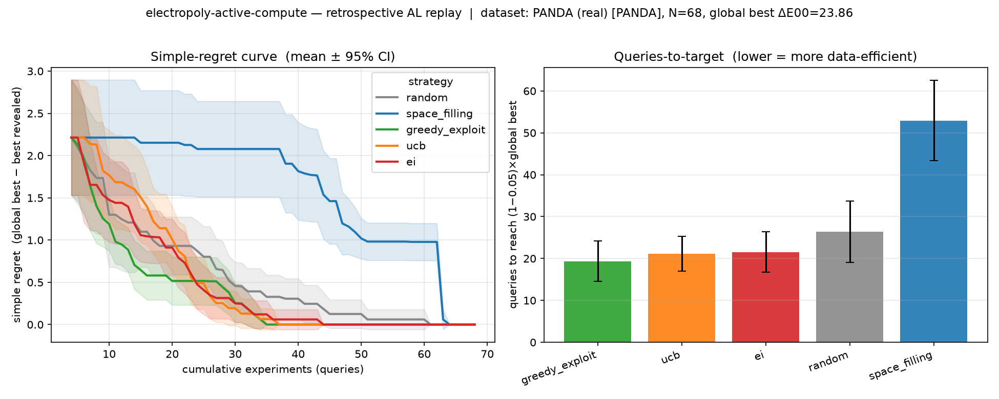

# ElectroPolyBench

ElectroPolyBench compares how efficiently active-learning strategies find
promising experimental conditions. It replays completed experiments so that
different strategies can be evaluated against the same measured outcomes,
without running a new laboratory campaign for every comparison.

## Approach

Each replay begins with a small set of revealed observations. A strategy then
selects the next condition, receives its measured outcome, and updates its
model. Repeating this process across shared random seeds produces comparable
learning curves and query counts.

The implementation includes random sampling, space filling, greedy
exploitation, upper confidence bound, and expected improvement. Gaussian-process
and random-forest surrogates share the same interface, allowing the query
strategy and predictive model to be varied independently.

## Case study: electropolymerization

The current benchmark uses 68 measured conditions from the PANDA PEDOT:PSS
campaign. Inputs are monomer concentration, deposition potential, and deposition
time; the objective is electrochromic optical contrast, ΔE00.

With four initial observations and a Gaussian-process surrogate, the recorded
20-restart comparison measured the queries needed to reach 95% of the best
observed contrast:

| Strategy | Mean queries |
| --- | ---: |
| Greedy exploitation | 19.35 |
| UCB | 21.10 |
| Expected improvement | 21.55 |
| Random sampling | 26.35 |
| Space filling | 52.95 |

These results describe selection within the measured 68-condition pool.
Confidence intervals and learning curves are included in the detailed results.

## Documentation and data

- [Running and configuring experiments](docs/experiments.md)
- [Results with confidence intervals](results/queries_to_target_summary.csv)
- [PANDA dataset](https://github.com/BU-KABlab/PANDA-SDL)
- Quinn et al., Materials Horizons (2024):
  [10.1039/D4MH00797B](https://doi.org/10.1039/D4MH00797B)
